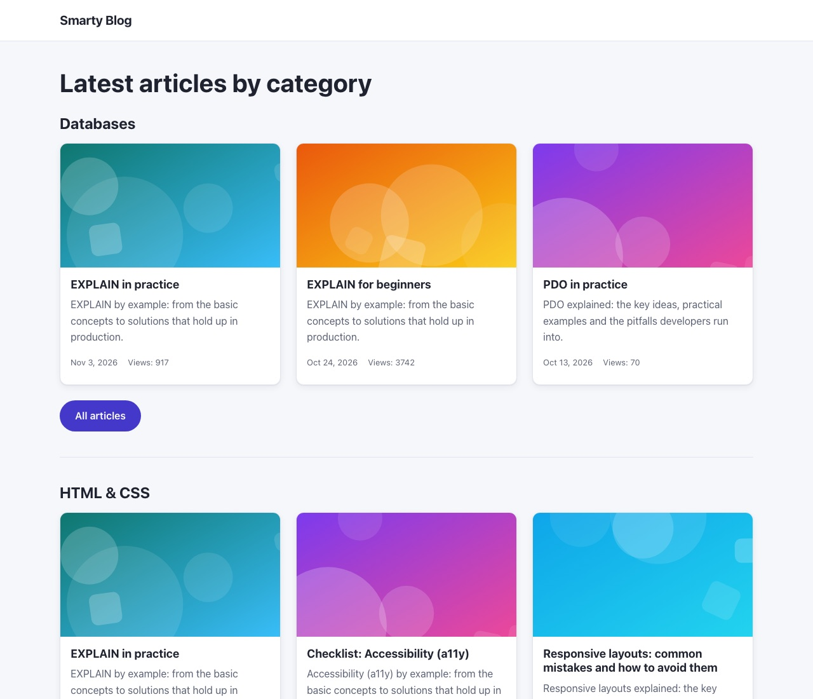
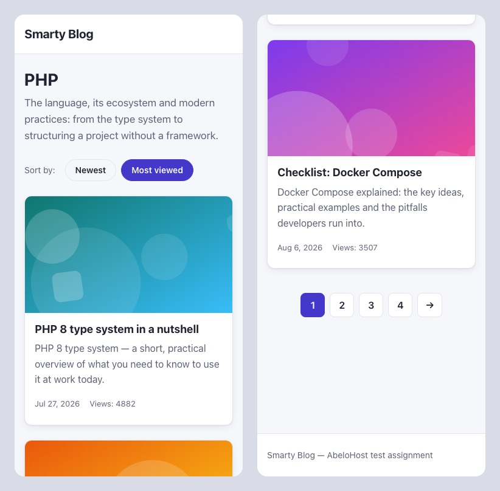
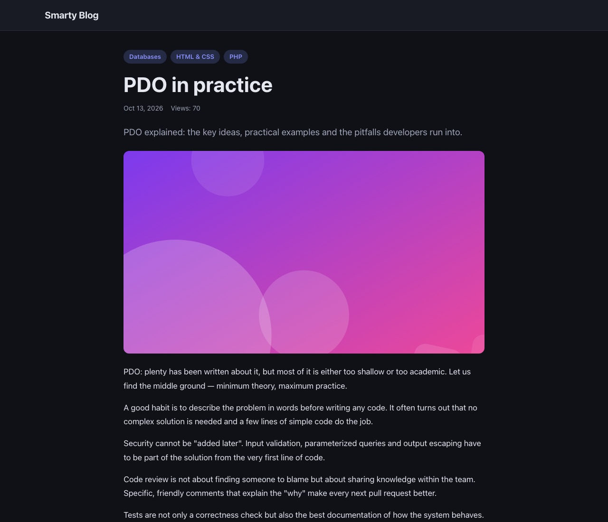

# Smarty Blog

A small but complete blog with categories and articles, built with **plain PHP 8.1+ (no framework)**,
**Smarty 5** and **MySQL 8**, as a test assignment for AbeloHost. Original task: [docs/TASK.md](docs/TASK.md).



| Category page on a phone | Article page, dark theme |
|---|---|
|  |  |

## Quick start

Requirements: Docker with Compose v2. Nothing else (no PHP, Composer or Node on the host).

```bash
git clone <repository-url> smarty-blog
cd smarty-blog
docker compose up -d --build
```

Open **http://localhost:8080**. The command returns once the site is ready; the first run takes about a
minute while images are pulled. On start the containers automatically:

1. install Composer dependencies,
2. apply database migrations,
3. seed demo data (only when the database is empty),
4. compile SCSS into `public/assets/css/app.css`.

Ports already taken? `APP_PORT=8081 DB_EXTERNAL_PORT=3308 docker compose up -d --build`
(all variables are listed in [.env.example](.env.example); a `.env` file is optional).

## Where to check each requirement

| Requirement | Where |
|---|---|
| Home: every category that has articles, its 3 latest posts, an "All articles" button | http://localhost:8080/ — the empty *Career* category is not shown |
| Category: name, description, article list | http://localhost:8080/category/php |
| Sorting by publication date / views | `?sort=date` (default) · `?sort=views` |
| Pagination | `?page=2` (9 per page); invalid or out-of-range pages return 404 |
| Article: all fields, categories, view counter | http://localhost:8080/article/pdo-in-practice |
| 3 similar articles | bottom of the article page — ranked by shared categories |
| Seeding | `docker compose exec php php bin/seed.php [--articles=300]` |
| 404 | http://localhost:8080/nope |
| SCSS, Docker | `scss/`, `docker-compose.yml` |

## Commands

```bash
docker compose exec php php bin/seed.php              # recreate demo data (80 articles by default)
docker compose exec php php bin/seed.php --articles=300
docker compose exec php php bin/migrate.php           # apply new migrations (also runs on start)
docker compose exec php php bin/migrate.php --fresh   # drop all tables and migrate again
docker compose up assets                              # rebuild CSS
docker compose run --rm assets npm run watch          # SCSS watch mode
docker compose logs -f php                            # PHP and application error log
APP_DEBUG=1 docker compose up -d php                  # show exception details on the 500 page
docker compose down -v                                # stop and delete the database volume
```

MySQL is reachable from the host at `127.0.0.1:3307` (user `blog`, password `secret`, database `blog`).

## Project structure

```
public/            document root: index.php (front controller), compiled CSS, article images
src/Core/          Router, Request, Response, View (Smarty), Database (PDO), NotFoundException
src/Controller/    HomeController, CategoryController, ArticleController
src/Repository/    CategoryRepository, ArticleRepository, ArticleSort enum — all SQL lives here
src/Entity/        readonly Category and Article entities
src/Support/       Pagination, Slugger, ViewedArticles (view-counter cookie)
templates/         Smarty layout, pages, partials and error pages
database/          SQL migrations and the seeder (BlogSeeder + source data)
bin/               CLI: migrate.php, seed.php
scss/              styles: abstracts, base (theme), layout, components (one BEM block per file)
docker/            PHP image (Dockerfile, entrypoint, php.ini overrides), Nginx config
docs/              task, architecture, decision records, progress and AI usage log
```

A request goes **Nginx → `public/index.php` → `Router` → controller → repository (PDO) → Smarty template
→ `Response`**. Details, the schema diagram and the queries behind every page:
[docs/ARCHITECTURE.md](docs/ARCHITECTURE.md).

## Database

Three tables: `categories`, `articles` and the many-to-many pivot `article_category` (composite primary
key plus a reverse `(category_id, article_id)` index), InnoDB, `utf8mb4`. `articles` has indexes on
`published_at` and `views` for sorting and a unique `slug` for URLs. Schema changes are numbered SQL
files in `database/migrations/`, tracked in a `migrations` table.

## Key decisions

Every decision is recorded with alternatives and rationale in [docs/DECISIONS.md](docs/DECISIONS.md). In short:

- **No framework, but a familiar shape** — front controller, a ~50-line router, controllers returning a
  `Response`, repositories with all SQL, readonly entities, Smarty templates. Dependencies are wired by
  hand in `index.php`; controllers and the DB connection are created lazily for the matched route only
  (ADR-002, ADR-007).
- **Home page in one query** — "3 latest per category" uses `ROW_NUMBER() OVER (PARTITION BY …)`
  instead of a query per category (no N+1) (ADR-009).
- **Sorting through an enum whitelist** — `ORDER BY` cannot be a bound parameter, so the `ArticleSort`
  backed enum maps `?sort=` to fixed SQL fragments; pagination is `LIMIT/OFFSET` with a separate
  index-only `COUNT(*)` (ADR-010).
- **View counter** — an atomic `UPDATE … SET views = views + 1`, counted once per browser via a validated
  cookie; similar articles come from a self-join on the pivot table ranked by shared categories (ADR-011).
- **Seeder** — own deterministic generator (fixed random seed) instead of Faker, so data is identical on
  every run and covers every scenario: multi-category articles, an empty category, several pages (ADR-008).
- **PHP version** — `"php": ">=8.1"` with Composer `platform.php = 8.1.0` keeps the code 8.1-compatible
  as required; Docker runs the supported PHP 8.3 because 8.1 is end-of-life (ADR-004).
- **Styles** — Dart Sass with `@use` modules, mobile-first, CSS custom properties with an automatic dark
  theme, compiled by a one-off `assets` container on `docker compose up` (ADR-012).

## Security

- SQL: prepared statements everywhere, real server-side prepares (`PDO::ATTR_EMULATE_PREPARES = false`),
  `ORDER BY` from an enum only, `LIMIT/OFFSET` bound as integers.
- XSS: Smarty `escape_html` is enabled globally — every `{$var}` is escaped; `nofilter` is never used.
- Input: route slugs must match `[a-z0-9-]+`, `?page` and the view cookie accept positive integers only.
- Runtime: production `php.ini` (no error display, no `X-Powered-By`), Nginx executes only `index.php`,
  hides its version and sends `X-Content-Type-Options`, `X-Frame-Options` and `Referrer-Policy`.

## Known limitations

- OFFSET pagination slows down on very deep pages; keyset pagination would be the next step at scale.
- The view-count cookie can be cleared to count a view again — acceptable for a blog.
- The home page query ranks every article–category link; at millions of rows a `JOIN LATERAL … LIMIT 3`
  variant would read fewer rows.

## Use of AI

AI (Claude Code) was used as an assistant throughout the project, under rules defined up front in
[CLAUDE.md](CLAUDE.md). **All architectural decisions were made by me**: for each stage the assistant proposed
2–3 options with trade-offs, I chose (sometimes against its recommendation — e.g. the `Response` object,
windowed pagination, the dark theme, `description` as `TEXT`), and the decision was recorded in
[docs/DECISIONS.md](docs/DECISIONS.md).

The assistant was used for:
- boilerplate and routine code after the approach was agreed (Docker setup, SCSS, seeder content, templates);
- verification: cross-checking query results against independent SQL, EXPLAIN analysis, screenshots
  at different widths, a final review of the whole project;
- documentation drafts and explanations of each step.

Every stage was reviewed and committed by me; the commit history shows the stage-by-stage progress.
A stage-by-stage log of what the AI did and what I decided: [docs/AI_USAGE.md](docs/AI_USAGE.md).

## License

[MIT](LICENSE)
